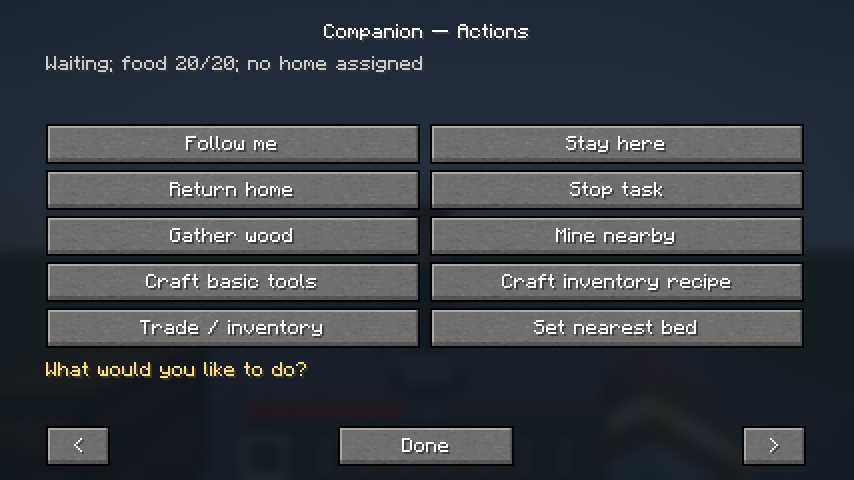
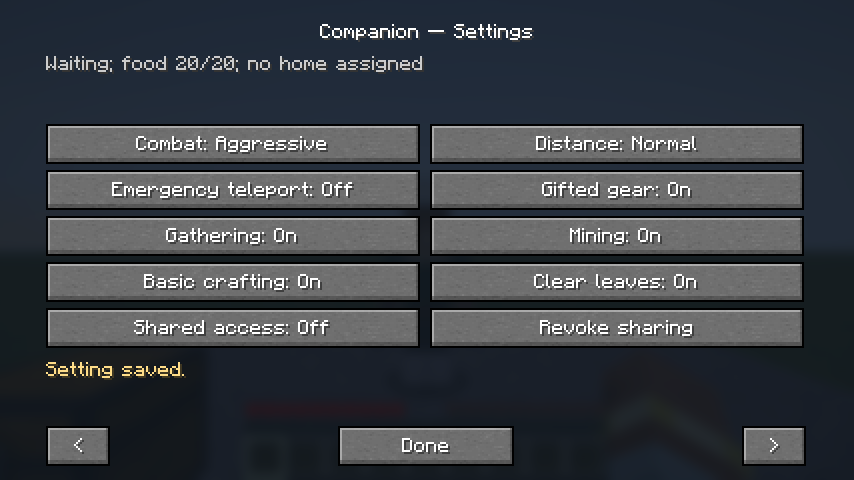

# Companion 0.3.0 — interaction UI and resource crafting

[Download the JAR](companion-0.3.0.jar?raw=true).
Previous [0.2.0](../companion-0.2.0) and [0.1.0](../companion-0.1.0) are unchanged.

Requirements: **Minecraft Java 26.3**, **Java 25**, **Fabric Loader 0.20.1**,
**Fabric API 0.165.0+26.3**. Install the same mod version on server and clients.
Back up your world. Move the old Companion JAR outside `mods/` into a backup
folder; only one Companion version can be active.

**Right-click your companion to open his menu.** Use the bottom arrows for
Actions, Settings, Equipment & Name, and Storage. Commands are optional after
initial spawning (`/companion spawn`). Sneak-right-click is still quick Stay.

New in this build:

- Real interaction UI: Follow/Stay/Home/Stop, inventory, resource tasks, basic
  crafting, name editing, implemented settings, and explicit shared transfers.
- Crafting searches for a reachable table within 16 blocks and walks there.
- Mine Nearby searches exposed, suitable nearby stone/ore without pointing at it.
- Assigned resource work can clear up to 12 obstructing leaves, with permission,
  protection, hazard, loot, and durability checks. Arbitrary buildings are not dug.
- Owned logs become real planks, sticks, a bench, and common tools through actual
  recipes. Craft Basic Tools explicitly permits placing an owned bench on a safe
  empty spot; automatic post-gather preparation never places blocks on its own.
- Earned stone/iron/diamond tool tiers can replace inferior tools while retaining
  the old equipment. Missing materials are never invented.
- Fixed resource pickup paths that could stop just outside pickup range.

Gather Wood explicitly permits nearby log harvesting: avoid using it beside
wooden buildings you want preserved. All previous behavior/commands remain.

[Full instructions](../../README.md) · [Test report](../../docs/TESTING_0.3.0.md)

**Death is still permanent.** Smelting, complete independent progression,
expeditions, daily routines, respawning/keepInventory/recovery, and other later
milestone systems remain unfinished. Use a backed-up test world.

Validation: **47 required server GameTests passed** (46 mod tests and one framework
test), plus the integrated client/menu test. The menu test performs real Follow/Stay,
settings changes, naming, shared withdrawal/deposit, and inventory opening.

## Menu preview

