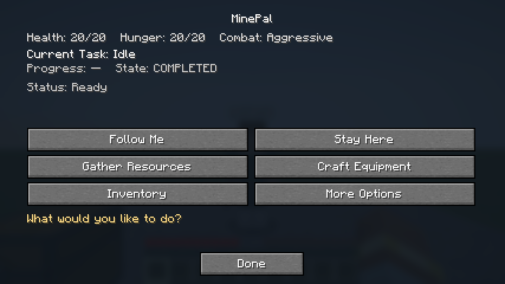
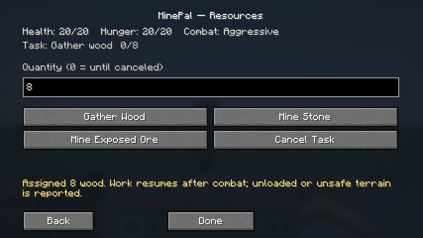
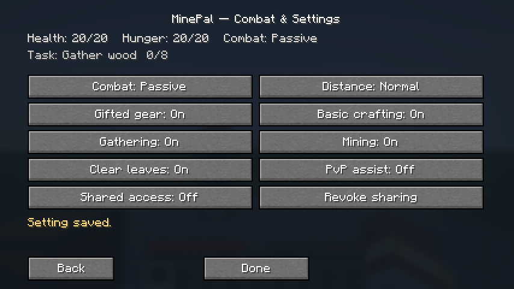
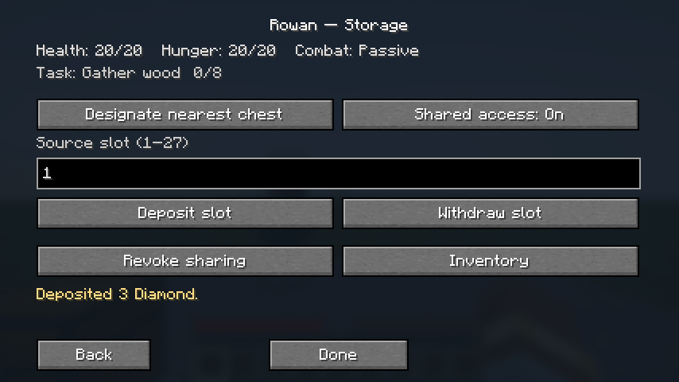

# MinePal / Companion 0.4.0

[Download installable JAR](companion-0.4.0.jar?raw=true) · [Source ZIP](companion-0.4.0-source.zip?raw=true) · [Installation and usage](../../README.md) · [Test report](../../docs/TESTING_0.4.0.md)

Requires Minecraft Java **26.3**, Java **25**, Fabric Loader **0.20.1** and Fabric API **0.165.0+26.3**. Use the same mod version on server and clients. Back up your world and move the old Companion JAR outside mods; keep only one active version. Right-click your companion for the menu. Existing companions retain their saved combat setting: select **More Options → Combat & Settings → Aggressive** for owner-selected animal assistance.

## Changes

- Progressive loaded-terrain exploration with remembered search cells and resource/table locations, quantity goals and persistent work state.
- Connected natural trunk/branch harvesting; actual resource/drop accounting and conservative staircase excavation from dirt into stone.
- Distant workstation travel and legitimate owned-material crafting/equipment progression.
- Owner attack detection including animals, real melee and weapon wear, configurable PvP default off, threat-aware walking retreat and task resumption.
- Six-option main UI with health, hunger, task quantity/state, cancellation and organized advanced settings.
- Navigation teleports disabled as requested; previous releases and original project specification preserved.

## Milestone status

| Request | Status in this release |
| --- | --- |
| 1 Exploration | Core implemented; bounded loaded-world search, no chunk loader or general expedition return |
| 2 Complete trees | Partial; connected accessible branches, no scaffold access to high crowns |
| 3 Excavation | Partial; inspected safe staircase segments, no general cave/ore engineering |
| 4 Workstations | Core implemented; temporary bench recovery remains unfinished |
| 5 Combat assistance | Implemented melee core; broader multiplayer and species validation remains |
| 6 Survival | Core scoring/walking retreat; no constructed shelter or ranged tactics |
| 7 Menu | Implemented six-option hierarchy with real client validation |
| 8 Persistence | Implemented ledger/controller serialization; full disk/long-session validation remains |
| 9 Reliability | 66 required server tests plus integrated client test passed; not every requested scenario covered |

This is an incremental release, not a claim that the whole overhaul is finished. High crowns stay blocked rather than falsely completed. Tree/build discrimination remains heuristic. Placed benches remain in the world. No smelting, full independent progression, death recovery or respawn: **death remains permanent**. Review the full README before use near valuable builds.

## Screenshots

Prior releases: [0.3.0](../companion-0.3.0), [0.2.0](../companion-0.2.0), [0.1.0](../companion-0.1.0).
